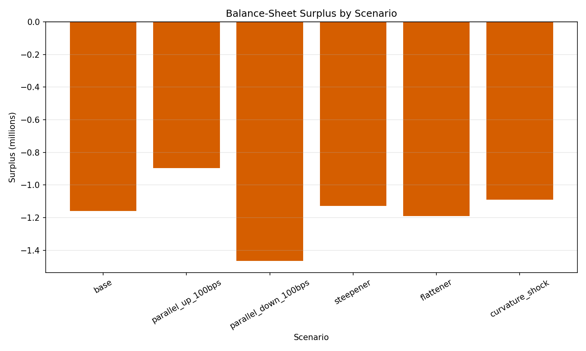
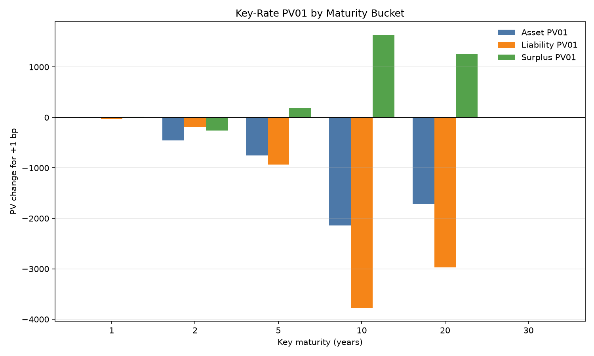

# yield-curve-alm-engine

[](https://github.com/sil-kong/yield-curve-alm-engine/actions/workflows/tests.yml)

A Python engine for asset-liability management (ALM) on a zero-coupon yield
curve. It values a fixed-rate bond portfolio against a liability cash-flow
schedule, measures how the surplus reacts to rate moves (duration, convexity,
key-rate PV01, deterministic curve stresses) and writes a reproducible Markdown
report. Curves can be the built-in example or real ECB euro area spot curves.

## Example result

On the example portfolio (5 fixed-rate bonds against 20 years of liability
outflows), [the generated report](docs/sample_alm_report.md) reads:

| | Value |
|---|---:|
| Asset market value | 6.61 M |
| Liability present value | 7.77 M |
| Surplus | −1.16 M |
| Asset / liability modified duration | 7.7 / 10.2 years |
| Duration gap | −4.3 years |
| Surplus change, +1 bp parallel (full revaluation) | +2,831 |
| Worst deterministic stress | parallel −100 bp: surplus −305 k |

Liabilities are longer than assets, so the surplus gains when rates rise and
loses when they fall. The key-rate breakdown shows that most of this exposure
sits at the 10Y and 20Y points.




## What the engine does

- **Curve**: continuously compounded zero curve, linear interpolation, discount
  factors, forward rates, 2s10s / 5s30s slope and 2s5s10s curvature.
- **Valuation**: fixed-rate bullet bonds from their full coupon schedule,
  liabilities as dated positive outflows, surplus = assets − liabilities.
- **Rate risk**: Macaulay and modified duration, convexity, duration gap,
  key-rate PV01 for assets, liabilities and surplus.
- **Stress testing**: parallel ±100 bp, steepener, flattener and curvature
  shock, each with full revaluation of both sides of the balance sheet.
- **Cash-flow matching**: annual asset/liability gaps and cumulative gap.
- **Market data**: fetches ECB AAA or all-ratings spot curves into a normalized
  local CSV; every valuation then runs offline from that file.
- **Reporting**: CSV tables, matplotlib figures and a Markdown ALM report.

## How the results are checked

The numbers are cross-checked against each other, and the checks are part of
the test suite:

- **Key-rate PV01 adds up to the parallel PV01.** Key rates use a
  piecewise-linear tent basis whose weights sum to one at every maturity. On
  the example, the surplus key-rate PV01s sum to 2,832 against 2,831 for a full
  +1 bp parallel revaluation.
- **Duration is measured against full revaluation.** For each parallel shock,
  the report shows the first-order estimate, the exact revaluation and the
  error: 0.07% at 1 bp, about 7.5% at 100 bp, where convexity matters.
- **Inputs are validated column by column.** Errors name the column, row and
  value, e.g. `bond portfolio column 'maturity_years' must be a whole number of
  coupon periods (row 3: 2.25)`. Rates entered as percentages, duplicate bond
  names and curves mixing several observation dates are rejected.
- **ECB curves use a single observation date.** Each maturity is a separate
  ECB series; the fetcher stops if they do not share the same date.

## Design choices

- **Continuous compounding.** `DF(t) = exp(−r(t)·t)` makes modified duration
  equal to Macaulay duration for a parallel zero-rate shift, which keeps the
  sensitivity formulas exact and easy to check.
- **Linear interpolation on zero rates, flat extrapolation.** Simple and
  transparent. It is also what makes the tent key-rate basis additive: weights
  that sum to one on the quoted points also sum to one between them.
- **Full revaluation for stresses.** Every scenario builds a new curve and
  re-prices both sides of the balance sheet; duration is only used as a
  comparison.
- **Fetch once, value offline.** Only the ECB command touches the network, so
  every result is reproducible from local files and the tests never call the
  API.

Details: [methodology](docs/methodology.md),
[data sources](docs/data_sources.md),
[reporting workflow](docs/reporting_workflow.md).

## Quick start

```bash
python3 -m venv .venv
.venv/bin/python -m pip install -e ".[dev]"
.venv/bin/python -m pytest

# Full report on the example inputs
yield-curve-generate-report \
  --curve-csv data/examples/example_zero_curve.csv \
  --bonds-csv data/examples/portfolios/example_bond_portfolio.csv \
  --liabilities-csv data/examples/liabilities/example_liability_cashflows.csv
```

With a real ECB curve:

```bash
yield-curve-fetch-ecb --curve-type aaa --date latest \
  --output data/market_curves/ecb/ecb_aaa_spot_latest.csv

yield-curve-generate-report \
  --curve-csv data/market_curves/ecb/ecb_aaa_spot_latest.csv \
  --bonds-csv data/examples/portfolios/example_bond_portfolio.csv \
  --liabilities-csv data/examples/liabilities/example_liability_cashflows.csv
```

All commands accept the same `--curve-csv`, `--bonds-csv` and
`--liabilities-csv` options. Without them they use built-in synthetic inputs.

| Command | Output |
|---|---|
| `yield-curve-build-base` | base-case valuation, durations, shock comparison |
| `yield-curve-run-stress` | surplus and bond prices under each stress |
| `yield-curve-build-dashboard` | summary metrics, key-rate and cash-flow gap tables |
| `yield-curve-plot-results` | figures (`--publish-docs-figures` updates `docs/figures/`) |
| `yield-curve-generate-report` | Markdown ALM report |
| `yield-curve-fetch-ecb` | normalized ECB spot curve CSV |

Each command also runs as `python -m yield_curve_alm_engine.scripts.<name>`.
Outputs are written to `outputs/`.

## Input formats

| File | Columns |
|---|---|
| Zero curve | `maturity_years`, `zero_rate` (decimal, continuously compounded) |
| Bond portfolio | `name`, `face_value`, `coupon_rate` (decimal), `maturity_years`, `coupon_frequency` |
| Liabilities | `time_years`, `cash_flow` (positive outflow) |

Examples are in [`data/examples/`](data/examples/).

## Project layout

```text
src/yield_curve_alm_engine/
├── curve/          zero curve, stress scenarios, curve analytics
├── instruments/    fixed-rate bonds, liability schedules
├── risk/           duration/convexity, key-rate PV01, surplus, cash-flow matching
├── data/ecb.py     ECB Data API ingestion
├── loaders.py      validated CSV inputs
└── scripts/        command-line entry points and reporting
tests/              pytest suite, run on every push by GitHub Actions
```

## Scope and limitations

This is a research prototype built to make ALM mechanics explicit, not a
production or regulatory tool. It does not bootstrap curves from traded
instruments, model credit spreads, accrued interest, day-count conventions or
stochastic rates, and liabilities are given cash-flow schedules rather than
actuarial projections.

Possible extensions: PCA-based curve scenarios, a credit spread layer,
day-count conventions, and stochastic short-rate models (Hull-White).

## License

MIT, see [LICENSE](LICENSE).
